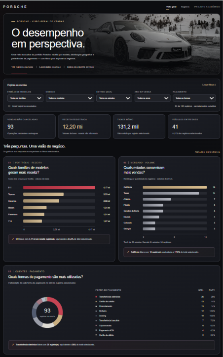
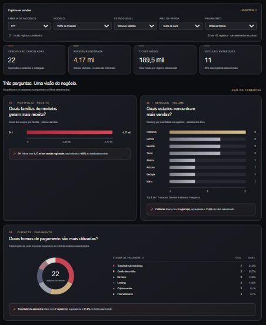

# Porsche · Visão geral de vendas

Projeto desenvolvido para um desafio da DIO, usando uma base de vendas Porsche para criar uma dashboard em HTML.

A ideia foi partir das perguntas de negócio e usar os gráficos para responder a elas. Também quis deixar a apresentação mais elegante, com uma aparência inspirada no site da Porsche Brasil, mantendo os dados fáceis de consultar.

## Dashboard publicada

👉 **[Abrir a dashboard](https://lealves1.github.io/dashboard_porsche_sales/)**

## Perguntas de negócio

As perguntas foram escolhidas para analisar três pontos: o desempenho dos modelos, a distribuição das vendas e as formas de pagamento.

| Pergunta | Por que escolhi | Como aparece na dashboard |
|---|---|---|
| Quais famílias de modelos geram mais receita? | Para ver quais grupos de modelos somam o maior valor em vendas. | Barras com a receita por família. |
| Quais estados concentram mais vendas? | Para saber onde estão as maiores quantidades de vendas da base. | Barras com o ranking dos estados. |
| Quais formas de pagamento são mais utilizadas? | Para ver quais aparecem mais e quanto cada uma representa no total. | Rosca com quantidades e percentuais. |

O gráfico de receita agrupa as versões em famílias, como 911, Cayenne e Macan. O filtro de modelo permite consultar uma versão específica. Os estados são dos Estados Unidos, conforme as localidades da planilha.

## Preparação e tratamento da base

A base de vendas Porsche foi fornecida pelo professor. Durante a aula, acompanhei o tratamento dos dados com apoio da IA, usando um plano de regras para organizar as informações da planilha.

Esse plano definia como padronizar datas, modelos, anos, preços, quilometragem, pagamentos, cidades, estados e status de entrega. O tratamento gerou as colunas chamadas de `Sanitized`, mantendo as informações originais ao lado para comparação. Os valores que não podiam ser tratados com segurança ficaram marcados como `INVALID`.

Depois, no Excel, excluí as colunas originais e mantive as tratadas para usar na dashboard. Também ajustei a coluna de preços, trocando o ponto pela vírgula para conseguir trabalhar com os valores em formato monetário no Excel. Os preços da base estão em dólares americanos (USD).

### Revisão das datas inválidas

Depois, pedi ajuda à IA para olhar de novo as datas que ficaram como `INVALID`. A ideia era criar uma nova regra e recuperar as que podiam ser corrigidas sem precisar adivinhar a data.

Algumas estavam no formato `AAAA/dia/mês`. Por exemplo, em `2024/15/07`, o 15 só pode ser o dia, porque não existe mês 15. A regra usa essa leitura quando o dia é maior que 12, o mês está entre 1 e 12 e a data existe no calendário.

Com isso, foi possível corrigir estas três datas:

| Data original | Data corrigida |
|---|---|
| `2024/15/07` | `2024-07-15` |
| `2025/18/11` | `2025-11-18` |
| `2027/15/04` | `2027-04-15` |

Das **24 datas inválidas**, **3 foram recuperadas** e **21 continuaram pendentes**. Para corrigir as outras, seria preciso confirmar a informação na origem. Os valores originais foram mantidos, e essa revisão não mudou os preços, modelos, pagamentos ou status.

Os registros sem data válida continuam nos totais de **Todos os anos**. Também dá para olhar só esses registros no filtro **Sem data válida**. Quando escolhemos um ano, esses registros ficam de fora porque não têm uma data válida para usar nesse filtro.

### Como os números são calculados

- A base tem **100 registros**. Cada linha representa uma operação.
- Ao abrir a dashboard, aparecem **93 registros**, porque os **7 cancelados** ficam de fora. Dá para incluí-los marcando a opção de cancelamentos.
- A **receita registrada** soma os preços dos registros selecionados, incluindo operações pendentes. O **ticket médio** divide essa soma pela quantidade de registros.
- O filtro de ano usa o **ano da venda**. O ano do veículo é outra informação.
- Os nomes de clientes e vendedores ficaram fora do HTML publicado.

## Pedido inicial e refinamentos

Meu pedido inicial foi criar uma dashboard em um único arquivo HTML, com três perguntas de negócio, indicadores e filtros. A referência visual escolhida foi o [site oficial da Porsche Brasil](https://www.porsche.com/brazil/pt/).

Este é um resumo organizado do pedido que fiz no início:

```text
Crie uma dashboard de vendas Porsche em HTML, em um único arquivo,
a partir da base fornecida.

Escolha três perguntas de negócio e responda cada uma com um gráfico
ou indicador. Inclua filtros para explorar os dados e indicadores
no topo, como total de vendas e receita.

Para o visual, use o site da Porsche Brasil como referência.
Quero uma aparência elegante e refinada, com cores e fontes
que combinem entre si.
```

Depois, fui pedindo ajustes em linguagem natural até chegar à versão final:

- Ajustei o título para **Porsche · Visão geral de vendas**, com a frase **O desempenho em perspectiva**.
- A versão final ficou com filtros por família, modelo, estado, ano da venda e pagamento.
- Pedi a revisão das datas inválidas e a atualização dos dados da dashboard, preservando o visual que já tinha escolhido.

Os pedidos foram feitos ao longo da conversa. O HTML foi sendo refinado conforme eu acompanhava o resultado e apontava o que queria mudar.

## Ferramentas e método de trabalho

Usei o **ChatGPT para gerar, visualizar e refinar o HTML**. O desenvolvimento principal aconteceu por meio da conversa e dos ajustes que fui solicitando. Depois, usei **Git e GitHub** para enviar o código e publicar a dashboard no **GitHub Pages**.

## O que é possível fazer na dashboard

- Consultar vendas não canceladas, receita registrada, ticket médio e veículos entregues.
- Filtrar por família de modelos, modelo, estado, ano da venda e forma de pagamento.
- Combinar filtros para analisar um recorte mais específico.
- Incluir cancelamentos ou voltar à visão inicial pelo botão de limpar filtros.
- Consultar os registros do recorte e exportá-los em CSV.
- Abrir **Sobre os dados e os cálculos** para consultar as regras usadas.

**Exemplo de uso:** ao selecionar a família **911**, os indicadores, os gráficos e a tabela passam a mostrar somente os registros daquela família. É possível combinar esse filtro com um estado ou uma forma de pagamento.

## Imagens do projeto

Capturas da dashboard Porsche, com a visão geral e um exemplo de filtro aplicado.





## O que aprendi com o projeto

Uma das ideias da aula que mais fez sentido para mim foi escolher a ferramenta de acordo com o problema que preciso resolver e entender o motivo dessa escolha.

Neste trabalho, comecei pelo tratamento da planilha, escolhi as perguntas com ajuda da IA e fui pedindo ajustes na dashboard. Depois, voltei à base para revisar as datas e publiquei o resultado no GitHub Pages.

Também entendi que um gráfico pode ficar bonito e ainda assim não responder ao que precisamos saber. Por isso, as perguntas de negócio e a revisão das datas mostraram que precisamos conferir os dados e entender até onde uma correção pode ir. Algumas datas puderam ser recuperadas; outras precisam de uma informação que não temos.

Para mim, esse foi o principal aprendizado: além de aprender a usar as ferramentas, entender como elas ajudam a resolver o problema e conferir o resultado. Foi isso que procurei praticar nesse trabalho, desde o tratamento da base até a publicação.

---

**Letícia Alves** · Projeto de estudo desenvolvido com auxílio de IA. A base é utilizada para estudo e não representa dados oficiais da Porsche.
